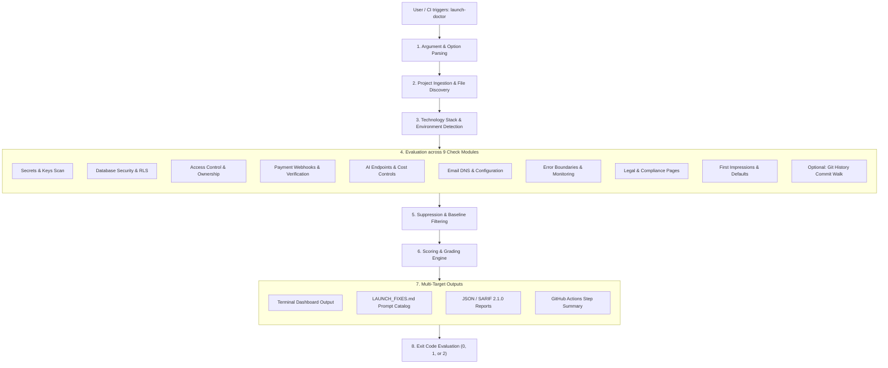
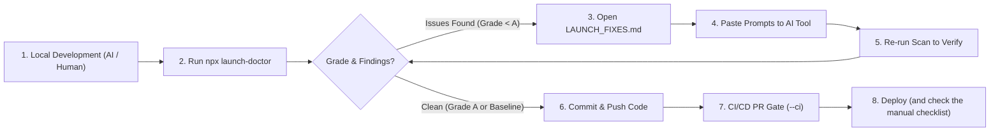

# Launch Doctor

**A pre-launch checkup for vibe-coded apps: one command, an A-F grade, and a fix prompt for every problem.**

[](https://github.com/SHARAJ379/launch-doctor/actions/workflows/ci.yml)
[](https://www.npmjs.com/package/launch-doctor)
[](https://nodejs.org/)
[](LICENSE)

Launch Doctor scans your project for common problems that hurt apps after launch: leaked API keys, databases anyone can read, endpoints that let one user reach another user's data, payments that can be faked, emails that land in spam, AI endpoints that can run up your bill, missing legal pages, and leftover template defaults. It is built for developers who ship with AI coding tools (Claude Code, Cursor, Lovable, Bolt, Windsurf) and may not read every line of generated code. Every finding is explained in plain English and includes a prompt you can paste straight back into your AI assistant. It has no runtime dependencies, requires no account, sends no telemetry, and your code never leaves your machine.

## Read this first

Launch Doctor is a **quick checklist with teeth, not a security audit**. Please trust it accordingly:

- **It reads your code with pattern rules.** It does not run your app, log in, or understand your business logic. It will sometimes flag code that is fine (a false alarm) and sometimes miss a real problem.
- **It cannot see your production settings.** Environment variables in Vercel or Netlify, and settings in the Supabase, Firebase or Stripe dashboards, are invisible to it. A typo in a production key or URL will not be caught.
- **A grade A means "none of the problems we look for were found"**, not "your app is secure".
- **It is new.** Version 0.x, first released in November 2026, maintained by one person. The checks are tested (see [How it is tested](#how-it-is-tested)), but it has not yet been used on many real projects, so expect rough edges and please [report them](#found-a-wrong-finding).

The full list is in [What it cannot do](#what-it-cannot-do).

## Quick start

```bash
npx launch-doctor
```

Scan the built-in sample app full of common mistakes:

```bash
npx launch-doctor --demo
```

Initialize configuration and GitHub Actions files:

```bash
npx launch-doctor init
```

Requires Node.js 22 or newer. That is the version range the automated tests cover (22 and 24). In a manual check it also ran on Node 18 and 20, but those versions are not tested on every change, so they are not officially supported.

## Example output

This is the `--demo` report, shortened. On a real project the last line tells you where `LAUNCH_FIXES.md` was saved (the demo doesn't write it).

```
  Launch Doctor v0.3.0
  Checked my-weekend-saas · 13 files · Vite, React, Supabase, Stripe, OpenAI

  Overall grade  F   Not ready to launch: fix 6 critical issues first

  F  Secrets & keys       2 critical · 1 to fix · 1 to check
  F  Database & backups   2 critical · 1 to check
  B  Access control       1 to fix · 1 to check
  F  Payments             1 critical · 2 to check
  F  AI & API costs       1 critical · 1 to fix · 1 to check
  B  Email delivery       1 to fix · 3 to check
  C  Errors & monitoring  2 to fix · 2 to check
  D  Legal & trust        5 to fix
  D  First impressions    5 to fix · 3 to check

  MUST FIX BEFORE LAUNCH (6)

  [CRITICAL] Stripe live secret key is written directly in your code
      src/lib/stripe.ts:1
      This file is sent to every visitor's browser, so anyone can copy the key
      (sk_live_…exe9) and use your account.

  [CRITICAL] Secret exposed through the public variable VITE_OPENAI_API_KEY
      .env:3
      Anything starting with VITE_ gets copied into your website's JavaScript,
      so every visitor can read it. That prefix is only for values that are safe
      to be public.
  ...
```

## Project workflow

Launch Doctor operates across two integrated workflows: an automated internal analysis pipeline that inspects your repository, and a developer-in-the-loop remediation lifecycle designed to pair with AI coding assistants.

### 1. Internal analysis pipeline

The following diagram outlines the multi-stage static analysis pipeline executed on every scan:



#### Pipeline stages in detail

1. **Argument parsing and validation (`src/cli.ts`):**
   Evaluates CLI flags, path arguments, targeted categories (`--only`, `--skip`), severity thresholds (`--fail-on`), output destinations (`--out`, `--sarif`), and runtime modifiers (`--ci`, `--offline`, `--history`, `--demo`).
2. **Project ingestion and tree traversal (`src/project.ts`):**
   Walks the project root, automatically skipping `node_modules`, build artifacts (`dist`, `build`, `.next`), binary formats, and hidden folders (except `.github`). Ingests package manifests (`package.json`, `requirements.txt`, `pyproject.toml`), git status, and `.launchdoctorignore` patterns.
3. **Stack and environment detection (`src/detect.ts`, `src/comments.ts`):**
   Identifies frameworks (Next.js, Vite, React, Vue, Express, FastAPI, Flask, Django), server routes, database configurations (Supabase, Firebase, Prisma), payment gateways (Stripe, Razorpay), error trackers (Sentry, PostHog), and email services. Prepares a comment-stripped view of source files so commented-out code is not mistaken for active protection.
4. **Multi-category check execution (`src/checks/`):**
   Runs audits across all 9 categories. If `--history` is enabled, an incremental git commit walker inspects the last `n` commits (default 500) for secrets that were removed from HEAD but remain exposed in commit history.
5. **Suppression and baseline matching (`src/baseline.ts`):**
   Applies inline `launch-doctor-ignore <id>` comments and `.launchdoctorignore` path or id rules. If `.launchdoctor-baseline.json` is present and baseline mode is active, matches existing findings by ID, relative file path, and line content fingerprint.
6. **Scoring and grading engine (`src/grade.ts`):**
   Calculates category and overall scores from weighted deductions. Strict scoring ceilings ensure that any critical finding caps both the category score and the overall score at 39 (grade F).
7. **Multi-target reporting and artifact generation (`src/report.ts`, `src/fixes.ts`, `src/sarif.ts`, `src/summary.ts`):**
   Renders the CLI terminal dashboard, generates `LAUNCH_FIXES.md` with copy-paste prompts for AI models, outputs structured JSON or SARIF 2.1.0 files when requested, and populates GitHub Actions job summaries via `GITHUB_STEP_SUMMARY`.
8. **Process exit resolution (`src/cli.ts`):**
   Returns exit code 0 whenever the scan finishes (with `--ci`, only when nothing is at or above `--fail-on`), code 1 for CI gate failures, and code 2 for invalid arguments or unexpected runtime errors.

---

### 2. Developer and AI remediation lifecycle

Launch Doctor is built to fit directly into your daily development cycle, especially when pairing with AI assistants:



1. **Pre-flight scan:** Before shipping changes or merging a branch, run `npx launch-doctor` in your workspace.
2. **Review findings:** Check your letter grade (A-F), category breakdown, and critical blockers in the terminal.
3. **Copy prompts to AI tools:** Open `LAUNCH_FIXES.md`. Copy the specific problem prompt or the single batch prompt and paste it into Claude Code, Cursor, Windsurf, Lovable, or Bolt.
4. **Verify remediation:** Re-run `npx launch-doctor` to verify the fixes and watch your grade increase.
5. **Establish baseline for legacy debt:** If you are adopting Launch Doctor on an existing project, run `npx launch-doctor --update-baseline` so CI only reports new issues.
6. **Automate CI gating:** Add `npx launch-doctor --ci` to your pull request workflow to catch regressions before they merge.

## What it checks

| Category | What it catches | Severity range |
|---|---|---|
| Secrets & keys (`secrets`) | Stripe, Clerk, OpenAI, Anthropic, OpenRouter, Groq, Hugging Face, Supabase, AWS, GitHub, Slack, SendGrid, Resend, Paddle, Convex, Appwrite, and Lemon Squeezy keys in code; Supabase `service_role` keys; private keys; database URLs with passwords; secrets in `NEXT_PUBLIC_` / `VITE_` / `EXPO_PUBLIC_` variables; keys in mobile app code (they ship inside the app); `.env` files committed or not in `.gitignore`; with `--history`, keys still in git history | Warning to critical |
| Database & backups (`database`) | Supabase tables without Row Level Security; policies that let anyone write (`using (true)`); write policies open to any signed-in user; Firebase test-mode or open rules; Convex mutations and actions anyone can call without signing in; Appwrite permissions that let anyone (or every signed-in user) change data; SQLite on serverless hosting; `prisma db push` / `--accept-data-loss` instead of migrations | Warning to critical |
| Access control (`access`) | Next.js Server Actions and API routes (Next.js, Express, tRPC, FastAPI, Flask, Django) that change data without checking who is calling, in apps that have accounts; signed-in handlers that load or change a record by an id from the request with no owner filter, owner comparison, permission helper or admin check (an IDOR); roles or plans read from Supabase `user_metadata` or Clerk `unsafeMetadata`, which users can edit; whole request bodies saved to the database (mass assignment) and DRF serializers with `fields = "__all__"`; admin checks that only exist in browser code; JWTs decoded without verifying, or the `none` algorithm; `supabase.auth.getSession()` trusted in server code | Warning to critical |
| Payments (`payments`) | Stripe, Lemon Squeezy, and Paddle webhooks that don't verify the signature (each route checked separately); webhooks or global `express.json()` that parse the body before verifying, or sign re-encoded JSON; no webhook at all; Razorpay payments never verified on the server | Warning to critical |
| AI & API costs (`costs`) | Paid AI or SMS APIs called from the browser; `dangerouslyAllowBrowser: true`; AI endpoints with no login check (middleware only counts if it really blocks `/api`); no real rate limiter | Warning to critical |
| Email delivery (`email`) | Resend's test sender; personal Gmail SMTP; sender domains that don't exist; missing SPF or DMARC (live DNS check); a checklist reminder when Supabase Auth still uses its built-in test mailer | Warning |
| Errors & monitoring (`monitoring`) | No error tracking or crash reporting (Sentry, PostHog, Crashlytics, and others); no error boundary or `error.tsx`, so crashes show a blank page | Warning |
| Legal & trust (`legal`) | No privacy policy, terms, refund policy, or contact page; no way for users to delete their account; a store app with no privacy policy link; a checklist reminder about cookie consent when analytics set cookies | Warning |
| First impressions (`first-impressions`) | "Vite + React" / "Create Next App" titles and descriptions; Vite favicon; Lovable default meta tags; no description or social preview image; hard-coded `localhost` URLs. For mobile apps: placeholder app IDs (`com.anonymous...`), cleartext HTTP on Android, `NSAllowsArbitraryLoads` on iOS, development addresses like `10.0.2.2` | Warning |

Most categories also add **"check yourself"** items for things code cannot show, such as automated database backups, provider spending limits, a real test purchase, uptime monitoring, switching Clerk to a production instance, and the app store listing and privacy forms.

Monitoring, legal, and first impressions checks run on web apps (a frontend framework, server routes, or an `index.html`) and on mobile apps (Expo and React Native), which get mobile versions of them: crash reporting, a privacy policy link for the stores, app ID and network security settings, and a store-readiness checklist. Command-line tools and libraries skip them automatically. In a monorepo with a website and an app, both sets run. A folder inside your project that is a separate git repository (it has its own `.git` folder and isn't a submodule) is left out, and the report says so.

## Live site scan

`npx launch-doctor scan https://myapp.com` checks your deployed site from the outside for a few things attackers and bots look for first. It makes a few dozen ordinary `GET` requests (at most about 90, when Supabase tables are tested) and never changes anything. Only scan sites you own or are allowed to test.

What it looks at: your home page, up to 20 JavaScript files that page loads, their source maps, a fixed list of file paths (`/.env`, `/.git/...`, `backup.sql` and similar), and Supabase tables named in that JavaScript. It does not crawl other pages, log in, fill in forms, or call your API, and it only tests whether Supabase tables can be **read**, not written.

| Category | What it catches | Severity range |
|---|---|---|
| Exposed files & keys (`live-exposure`) | `/.env`, `/.git` and SQL backups that can be downloaded (the content is verified, so single-page apps that answer 200 for every path are not flagged); public source maps; API keys inside the JavaScript every visitor downloads | Warning to critical |
| Open database (`live-database`) | Supabase `service_role` key in the page; tables that return rows to anyone holding the public anon key (only `GET`, one row per table, and rows are never saved or shown) | Critical |
| HTTPS & headers (`live-headers`) | Plain http; http that doesn't redirect to https; missing HSTS, Content-Security-Policy, `X-Content-Type-Options`, frame protection and `Referrer-Policy` | Warning to critical |

The report uses the same grades and `--json`, `--ci`, `--fail-on`, `--out` and `--no-file` options. Fix prompts go to `LAUNCH_FIXES_LIVE.md` in the current folder. Run `npx launch-doctor scan --help` for the options.

## Grading

- **Category score** = 100 − 50 per critical finding − 15 per warning.
  - Any critical finding caps the category at 39, which is an F.
  - Without a critical finding the score never drops below 40, so warnings alone cannot produce an F.
- **Overall score** is the weighted average of the categories that ran:
  - Weights: secrets (3), database (3), access control (3), payments (3), costs (2), email (1), monitoring (1), legal (1), and first impressions (1).
  - Categories that do not apply, or are skipped with `--only` / `--skip`, are excluded.
- **Caps on the overall score:**
  - Any critical finding anywhere caps the overall score at 39 (F).
  - Any warning caps it at 89, so an A requires zero warnings and zero critical issues.
- **Grade tiers:** A ≥ 90, B ≥ 75, C ≥ 60, D ≥ 40, F < 40.
- "Check yourself" items do not alter the numerical grade. Baseline findings count toward the grade for awareness, but are ignored by the `--ci` exit code.

## CLI reference

```
npx launch-doctor [folder] [options]
npx launch-doctor init [folder]
npx launch-doctor scan <url> [options]
npx launch-doctor mcp
```

| Flag | Default | Description |
|---|---|---|
| `[folder]` | `.` | Project folder to check |
| `--domain <domain>` | auto-detected | Domain you send email from; checks SPF, DKIM and DMARC |
| `--out <file>` | `LAUNCH_FIXES.md` in the project | Where to save the fix prompts |
| `--no-file` | off | Don't write the fix prompts file |
| `--json` | off | Print the full report as JSON (no fix file unless `--out` is given) |
| `--sarif <file>` | off | Also write a SARIF 2.1.0 file for GitHub code scanning |
| `--pr-comment` | off | On a GitHub pull request, post a summary comment and inline fix prompts (see [Pull request comments](#pull-request-comments)) |
| `--offline` | off | Skip network checks (email DNS) |
| `--ci` | off | Exit with code 1 on findings at or above `--fail-on` (no fix file unless `--out`) |
| `--fail-on <level>` | `critical` | With `--ci`, the lowest severity that fails: `critical` or `warning` |
| `--only <ids>` | all | Run only these categories (comma-separated) |
| `--skip <ids>` | none | Skip these categories (comma-separated) |
| `--history` | off | Also look for keys still in git history |
| `--history-depth <n>` | `500` | How many commits `--history` reads |
| `--update-baseline` | off | Save today's findings to `.launchdoctor-baseline.json` as accepted |
| `--no-baseline` | off | Ignore `.launchdoctor-baseline.json` and show every finding |
| `--demo` | off | Scan a built-in sample app full of mistakes |
| `-h`, `--help` | | Show help |
| `-v`, `--version` | | Show the version |
| `init [folder]` | `.` | Create `.launchdoctorignore` and `.github/workflows/launch-doctor.yml` (never overwrites) |
| `scan <url>` | | Check your deployed site from the outside (see [Live site scan](#live-site-scan)) |
| `mcp` | | Start an MCP server so AI coding tools can run checks themselves (see [MCP server](#mcp-server)) |
| `--no-db` | off | With `scan`, don't test Supabase tables with the public key found in the page |

Category ids for `--only` and `--skip`: `secrets`, `database`, `access`, `payments`, `costs`, `email`, `monitoring`, `legal`, `first-impressions`. Skipped categories show as "skipped" and don't count toward the grade.

**Exit codes**

| Code | Meaning |
|---|---|
| `0` | The scan finished (and with `--ci`, no findings at or above `--fail-on`) |
| `1` | `--ci` was given and there are findings at or above `--fail-on` (baseline findings excluded) |
| `2` | Usage error (unknown flag, invalid argument, folder not found) or a crash |

## Configuration

### `.launchdoctorignore`

One entry per line. Run `npx launch-doctor init` to generate a starter template.

```
no-error-tracking
no-account-deletion
legacy/
scripts/seed.ts
**/*.fixture.ts
```

A plain word without path characters represents a finding id. Anything containing `/`, `*`, or `.`, or matching an existing file or folder on disk, is treated as a path pattern. Finding ids that do not correspond to any known check produce a warning to catch typos.

### Inline ignores

To silence a specific finding at a single line, place a `launch-doctor-ignore <id>` directive on that line or the line directly above it. All directive styles are supported (`//`, `#`, `/* */`, `<!-- -->`, SQL `--`), and multiple ids can be separated by commas:

```ts
// launch-doctor-ignore stripe-test-key
const STRIPE_TEST_KEY = 'sk_test_...';
```

### Baseline

When adding Launch Doctor to an existing codebase, record current findings so CI checks focus exclusively on new issues:

```bash
npx launch-doctor --update-baseline
```

On subsequent runs:
- Matching findings are tagged with `baseline: true` in JSON output.
- They are summarized in terminal output as a single "N existing issues (baseline)" line.
- They are excluded from `--ci` / `--fail-on` failure checks.

Findings are tracked by check ID, file path, and a fingerprint of the offending line, preserving baseline matches even as line numbers shift. Run with `--no-baseline` to display all suppressed findings.

## CI integration

The `npx launch-doctor init` command creates this GitHub Actions workflow:

```yaml
name: Launch Doctor
on: [pull_request]
jobs:
  check:
    runs-on: ubuntu-latest
    steps:
      - uses: actions/checkout@v7
      - uses: actions/setup-node@v7
        with:
          node-version: 22
      - run: npx launch-doctor --ci
```

- **Severity gating:** By default, `--ci` exits with code 1 only on critical findings. Add `--fail-on warning` to fail builds on warnings as well.
- **Job summaries:** When running in GitHub Actions, Launch Doctor automatically writes a markdown summary (including overall grade, category scorecard, and itemized issues with their file and line) to the GitHub Actions job summary tab via `GITHUB_STEP_SUMMARY`.
- **Step outputs:** When `GITHUB_OUTPUT` is set, the `grade`, `score`, `critical` and `warnings` values are saved as step outputs.
- **Code scanning alerts:** Export findings to SARIF 2.1.0 format to populate alerts directly in your repository Security tab. The upload step needs permission to write security events, so add it to the job:

```yaml
    permissions:
      contents: read
      security-events: write
    steps:
      # ...checkout and setup-node as above...
      - run: npx launch-doctor --sarif launch-doctor.sarif --no-file
      - uses: github/codeql-action/upload-sarif@v3
        if: always()
        with:
          sarif_file: launch-doctor.sarif
```

### Pull request comments

The Launch Doctor GitHub Action reviews each pull request like a teammate would:

- **Inline comments** on the lines the pull request adds, each with the plain-English risk, a fix prompt you can paste into your AI tool, and the `launch-doctor-ignore` comment that silences it.
- **One summary comment** with the grade, what this pull request added, what was already in the project, and the category scorecard. It is edited in place on every push, not posted again.
- Findings that were already commented on are not repeated, findings in `.launchdoctor-baseline.json` are left out, and each run posts at most 20 inline comments (the rest are listed in the summary).

```yaml
name: Launch Doctor
on: [pull_request]
permissions:
  contents: read
  pull-requests: write
jobs:
  check:
    runs-on: ubuntu-latest
    steps:
      - uses: actions/checkout@v7
      - uses: SHARAJ379/launch-doctor@v0
```

| Input | Default | Description |
|---|---|---|
| `path` | `.` | Folder to check, relative to the repository root |
| `fail-on` | `critical` | Lowest severity that fails the check: `critical`, `warning` or `never` |
| `comment` | `true` | Post the summary and inline comments on pull requests |
| `args` | | Extra options, for example `--offline --skip legal` |
| `github-token` | `${{ github.token }}` | Token used for the comments |

The action also sets the `grade`, `score`, `critical` and `warnings` outputs. Pull requests from forks get a read-only token, so they can't be commented on; the check still runs and the job summary still has the results.

Using the CLI directly instead? Add `--pr-comment` and pass the token: `npx launch-doctor --ci --pr-comment` with `env: GITHUB_TOKEN: ${{ github.token }}`.

## Using with AI coding tools

Launch Doctor outputs `LAUNCH_FIXES.md` directly into your project root. Each entry includes the exact file and line number, an explanation of the risk, and a tailored prompt ready to paste into your AI assistant. It also includes a single batch prompt at the top of the file.

### With Claude Code

```bash
! npx launch-doctor
Fix the issues in LAUNCH_FIXES.md one at a time, starting with the critical ones. Explain each change before making it.
```

### With Cursor, Windsurf, Lovable, or Bolt

1. Run `npx launch-doctor` in your integrated terminal.
2. Open `LAUNCH_FIXES.md`.
3. Copy one fix prompt into the chat window.
4. Review and accept the code edit.
5. Re-run `npx launch-doctor` to observe your score improve.

### MCP server

`launch-doctor mcp` starts a [Model Context Protocol](https://modelcontextprotocol.io) server, so your AI assistant can run the checkup itself, read the findings and fix them without you copying anything.

**Claude Code:**

```bash
claude mcp add launch-doctor -- npx -y launch-doctor mcp
```

**Cursor** (`.cursor/mcp.json`) and other tools that use the same format:

```json
{
  "mcpServers": {
    "launch-doctor": { "command": "npx", "args": ["-y", "launch-doctor", "mcp"] }
  }
}
```

Then ask: *"Run Launch Doctor on this project and fix the critical findings one at a time."*

| Tool | What it does |
|---|---|
| `scan_project` | Checks a folder (default: the one the assistant works in). Returns the grade, every finding with its file, line, explanation and fix prompt, and the checklist of things to verify by hand. Options: `path`, `only`, `skip`, `offline`, `domain`, `history`, `includeBaseline`. |
| `scan_url` | Checks a deployed site from the outside, like `launch-doctor scan <url>`. Options: `url`, `skipDatabase`. |
| `list_checks` | Lists the categories and every finding id, for `only`, `skip` and `.launchdoctorignore`. |

The tools only read: nothing is written to your project, and results also come back as structured data for clients that use it. The server speaks MCP over stdio (protocol versions 2024-11-05 to 2025-11-25) and has no dependencies.

## Privacy and network use

Launch Doctor analyzes your codebase locally on your device. Your source code, findings, and credentials are never uploaded to any remote server. Detected secrets are masked in reports (for example, `sk_live_…exe9`).

- **Email DNS validation:** This is the only network check a folder scan performs. When your project sends transactional email and a domain is identified (either discovered in code or specified via `--domain`), Launch Doctor queries your system DNS resolver for NS and TXT records (including root SPF, `send.<domain>`, `_dmarc.<domain>`, and common DKIM selectors). No code or private data is transmitted. Pass `--offline` to disable DNS lookups entirely. The `--demo` command never touches the network.
- **Live site scan (`scan <url>`):** sends ordinary `GET` requests to the address you give, to the JavaScript files and source maps that page loads (which may be on another domain, such as a CDN), and to your Supabase project when the page uses one. For the Supabase test it sends the public anon key it found in your page back to your own Supabase project. Nothing else is sent, and nothing is uploaded.
- **No telemetry:** Launch Doctor does not collect usage data or phone home.
- **Git history analysis (`--history`):** Runs local `git log` commands directly on your system without network requests.
- **Pull request comments (`--pr-comment`):** calls the GitHub API with the workflow's token to read the pull request's changed files and post comments. It only runs on GitHub Actions and sends finding titles, explanations, fix prompts and file paths, never your source code.
- **MCP server (`mcp`):** talks to your AI tool over stdin and stdout only; it opens no port. Its tools make the same network calls as the CLI: email DNS lookups for `scan_project` (unless `offline`), and the requests to the site you name for `scan_url`.
- **Package installation:** standard `npx` retrieval via the npm registry.

## What it cannot do

Launch Doctor is useful because it is fast and specific. That also means it has clear blind spots. If any of these matter for your app, use another tool or a human review as well.

**It doesn't see your running app or your production settings**
- Production environment variables (Vercel, Netlify, Render and others) are invisible. A malformed URL, a wrong key or a bad model name in production will not be caught.
- Settings made in the Supabase, Firebase or Stripe dashboards are invisible. Tables created in the Supabase dashboard (rather than in SQL migrations in your repo) can't be checked for Row Level Security from the code, so you only get a reminder (`scan` can at least test whether they can be read on your live site).
- It doesn't run your app, call your API or read your logs (apart from the `GET` requests of `scan`), so errors that only happen at runtime are not found.

**It doesn't do a full security review**
- Its authorization checks (the `access` category) look for specific, common patterns, not every way access control can fail. They follow one handler at a time: a sign-in check, an owner filter or a permission check done somewhere they can't see (a shared data-access layer, a database rule set up in a dashboard, an ORM extension) is invisible to them, so they may raise a false alarm. A handler that compares the wrong ids, checks the wrong role, or writes something harmless-looking next to the real query may pass. Express handlers are only analysed when they are written inside the `app.get(...)` / `router.post(...)` call; handlers defined in another file and registered by name are not followed. Apart from that, the access-control rules it understands are Supabase RLS in SQL files, Firebase rules files, Appwrite permissions, and whether Convex functions check who is calling.
- It doesn't look for XSS, SQL injection, CSRF, SSRF or similar code-level vulnerabilities.
- It doesn't check your dependencies for known vulnerabilities. Use `npm audit`, `pip-audit` or Dependabot for that.
- It is not a penetration test, and its legal-page checks are reminders, not legal advice.

**It decides by patterns, so it can be wrong both ways**
- Logins, rate limiters and webhook checks are recognised by common names and libraries. Code written in an unusual way may be reported as missing (a false alarm), and code that only looks right may pass (a miss).
- Route analysis follows local imports 2 levels deep. Dynamic imports and unusual route shapes may not be followed.
- API-only backends can get legal-page warnings (privacy policy, terms) that may not apply to them.
- A folder with very little code (for example only a README) can get an A, because there was nothing to find.

**Coverage depends on your stack**
- **Deepest:** JavaScript and TypeScript web apps (Next.js, Vite/React, Express and similar), with Supabase, Firebase, Prisma, Stripe, Razorpay, and the common AI and email providers.
- **Good:** Python (FastAPI, Flask, Django): secrets, AI costs, Stripe webhooks, Supabase and the web-app checks. Clerk, Convex, Appwrite, Paddle and Lemon Squeezy have their own checks (new in 0.3.0, so less tried than the ones above).
- **Mobile (new in 0.3.0):** Expo and React Native apps get mobile versions of the checks. Launch Doctor reads the Expo config (`app.json`, `app.config.*`), `AndroidManifest.xml` and `Info.plist`; Gradle and Xcode project files are not read, and native Swift, Kotlin and Java code is not scanned at all.
- **Basic:** Ruby, PHP and Go are scanned for hard-coded secrets and a few patterns, but their frameworks and dependency files are not understood.

**It skips some files**
- `node_modules`, `dist`, `build`, `out`, `coverage`, `vendor`, `venv`, `target`, `generated` and a few other build or dependency folders, and hidden folders other than `.github` (such as `.venv` and `.next`).
- Files over 1 MB, minified `.min.js` files, source maps and binary files.
- Everything after the first 20,000 files (the report says when this happens).

For apps that handle significant money or sensitive personal or health data, use Launch Doctor as a first pass and get a human security review.

## How it is tested

- 210 automated tests run on every change, on Windows, macOS and Linux, with Node.js 22 and 24.
- Every check that existed in 0.2 has been confirmed against a small project (or fake site) that contains exactly that problem, and every command in this README has been run (the `scan` examples against a local test site rather than a real one).
- The features new in 0.3.0 (the GitHub Action, the MCP server, mobile apps, and Clerk, Convex, Appwrite, Paddle and Lemon Squeezy) have their own tests and were spot-checked by hand, which found and fixed two bugs before release. They have been tried less than the older checks. Posting pull request comments is tested against a fake GitHub API; it has not yet run on many real pull requests.
- The access-control category (new, not yet released) has 40 tests of its own, covering each rule and the correct patterns it must accept. It was also run on eight public open-source apps: Vercel's AI Chatbot, Taxonomy, Vercel's Next.js Subscription Payments starter, Next.js SaaS Starter, BoxyHQ SaaS Starter Kit, Documenso, the FastAPI full-stack template and OWASP Juice Shop. That turned up false alarms with six causes: admin-only FastAPI routes, admin-only tRPC procedures, a cookie mistaken for a database write, ownership checked by an earlier query in the same handler, ownership left to a helper called with the user's id, and a browser token library in a frontend it doesn't recognise. Each cause was fixed and has a regression test. What remains is one finding on a FastAPI route that has no sign-in check but is only mounted in local development, and one on Juice Shop decoding a token to show the login time; both match what the code does. It did not find Juice Shop's deliberate basket IDOR, because those handlers are registered from another file.
- Every bug fix gets a regression test, so the same mistake doesn't come back.
- What hasn't happened yet is wide real-world use. Most false alarms are found when the tool meets code written differently from what it has seen, so your reports make the biggest difference.

## Found a wrong finding?

If Launch Doctor reports something that is fine, misses a real problem, or crashes, please open an issue: [report a false alarm](https://github.com/SHARAJ379/launch-doctor/issues/new?template=false_positive.yml) or [report a bug](https://github.com/SHARAJ379/launch-doctor/issues/new?template=bug_report.yml). A short code snippet that reproduces it (with any keys removed) is the most helpful thing you can include. Fixes are released as small patch versions.

Meanwhile you can silence a finding with `.launchdoctorignore` or an inline `launch-doctor-ignore` comment (see [Configuration](#configuration)).

## Roadmap

Planned work, in no fixed order and without dates:

- [x] Live URL inspection (`launch-doctor scan <url>`: exposed `.env`, source maps, security headers, open Supabase tables via anonymous key)
- [x] GitHub Action that posts a summary and inline fix prompts on pull requests ([Pull request comments](#pull-request-comments))
- [x] Model Context Protocol (MCP) server for direct Claude Code and Cursor integration ([MCP server](#mcp-server))
- [x] Extended provider coverage (Clerk, Convex, Appwrite, Lemon Squeezy, Paddle)
- [x] Mobile framework support (Expo, React Native)

## Contributing

See [CONTRIBUTING.md](CONTRIBUTING.md) for local environment setup, architecture notes, and instructions on creating new checks. All contributors are expected to adhere to the [Code of Conduct](CODE_OF_CONDUCT.md).

## Contributors

Thanks to everyone who has helped build Launch Doctor. Contributors are listed here once their pull request is merged.

- [@SHARAJ379](https://github.com/SHARAJ379): creator and maintainer

Want to be on this list? Reporting a false alarm with a small example is a great first contribution, and issues labelled `good first issue` or `help wanted` are a good place to start once there are some.

## Security

Please do not report security vulnerabilities in public issues. Refer to [SECURITY.md](SECURITY.md) for instructions on confidential disclosure.

## License

[MIT](LICENSE)
